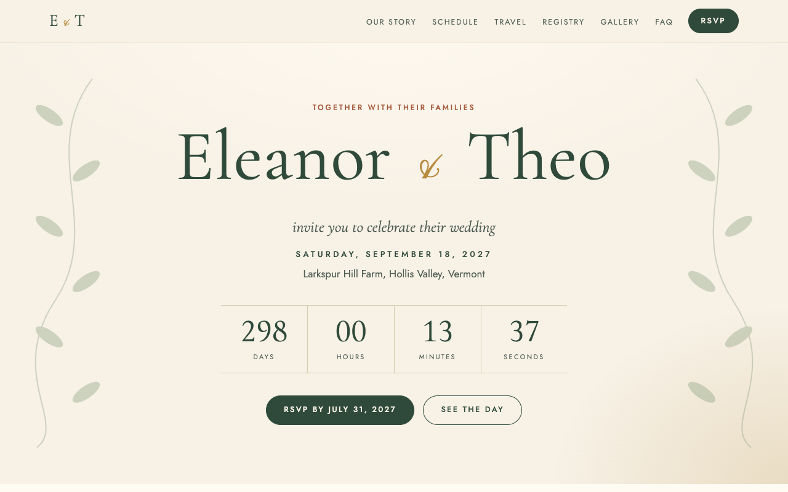

# Wedding website template

An elegant one-page wedding website with a live countdown, your story, the day's schedule, travel details, registry links, a gallery and an RSVP form.



[](https://console.cloudzyro.com/new?repo=https://github.com/Cloudzyro/template-wedding)

## What's included

- Your names, date and venue up top, with a live countdown to the ceremony (guests without JavaScript see the plain date)
- Our story, told in short chapters
- The day's schedule as a timeline
- Venue with a map link, parking notes, airports, shuttles and hotel suggestions
- RSVP form: name, email, attending or not, number of guests, meal choice, a song request and a note
- Registry links
- A gallery of soft illustrated placeholders, ready to swap for your own photos
- FAQ with dress code, kids, weather, accessibility and more
- Fully static output, so it loads fast and never sleeps
- Self-hosted fonts (Cormorant Garamond, Pinyon Script and Jost), no tracking and no third-party scripts
- Title, description and Open Graph tags, sitemap, robots.txt, favicon and a 404 page
- Responsive down to 360px, visible focus styles, and reduced motion respected

## Run it locally

You need Node.js 20 or newer and pnpm.

```bash
pnpm install
pnpm dev       # http://localhost:4321
pnpm build     # static site in dist/
pnpm preview   # serve the built site
```

## Make it yours

- **Content:** everything (names, date, story, schedule, venue, hotels, registry, meals, gallery captions, FAQ, contact email) is in `src/content/site.ts`. Edit that one file and the page updates.
- **Date and countdown:** set `date` in `src/content/site.ts` to the ceremony start with the venue's UTC offset, for example `2027-09-18T16:00:00-04:00`, and update `dateLabel` to match.
- **RSVP form:** set `PUBLIC_FORM_ENDPOINT` to an address that accepts form posts, such as a Formspree or Basin form, or a Supabase function. Copy `.env.example` to `.env` for local use, or set it in your host's environment settings, then rebuild. Answers are sent as a normal form post with the fields `name`, `email`, `attending`, `guests`, `meal`, `song` and `note`. With no endpoint set, the form shows a short note and opens an email to `contactEmail` with the answers filled in.
- **Photos:** the gallery and venue use illustrated placeholders from `src/components/Art.astro`. To use your own photos, put them in `public/` and replace the `<Art ... />` tags in `src/pages/index.astro` with ``.
- **Colors and fonts:** change the variables at the top of `src/styles/global.css`. Fonts are imported in `src/layouts/Base.astro` from Fontsource packages.
- **Your address:** set `site` in `astro.config.mjs` to your own address so the sitemap, robots.txt and social previews point at it. The social preview image is `public/og.png` (1200x630).

## Deploy

Click the Deploy to Cloudzyro button above, or push your own copy to GitHub and connect it in the Cloudzyro console. The build command is `pnpm build` and the output folder is `dist`. Remember to set `PUBLIC_FORM_ENDPOINT` if you want RSVPs collected online.

## Stack

- [Astro](https://astro.build) 7, static output
- Hand-written CSS with custom properties
- Fonts from [Fontsource](https://fontsource.org)
- `@astrojs/sitemap`

## License

MIT, see [LICENSE](./LICENSE).
